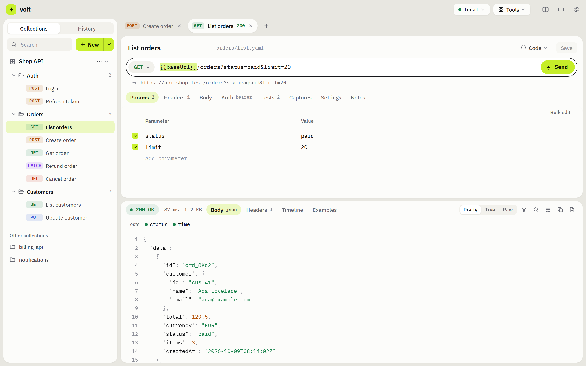
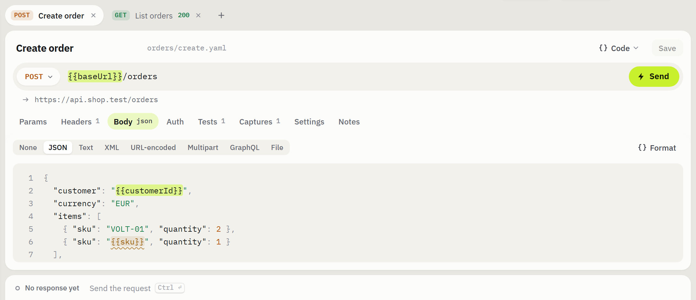
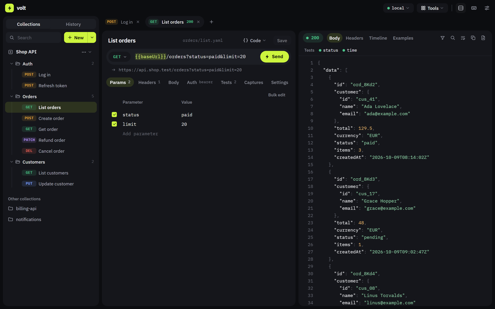

<p align="center"></p>
<h1 align="center">volt</h1>

<p align="center">
  <b>An API client whose collections are plain YAML files in your repository.</b><br>
  No account. No cloud. No telemetry. Fast, native, and yours.
</p>

<p align="center">
  <a href="https://github.com/mertgundoganx/volt/releases/latest"></a>
  <a href="https://github.com/mertgundoganx/volt/actions/workflows/ci.yml"></a>
  <a href="LICENSE"></a>
  
</p>

<p align="center">
  <a href="https://github.com/mertgundoganx/volt/releases/latest"><b>Download</b></a> ·
  <a href="docs/guide.md">Guide</a> ·
  <a href="#coming-from-postman">Coming from Postman</a> ·
  <a href="#build-it-yourself">Build it</a>
</p>



## Why volt

Most API clients keep your collections in their cloud and hand you an opaque
export if you ask nicely. volt has no storage of its own: **a collection is a
folder of YAML files.** One request, one file.

- **It lives with your code.** Requests sit in the repository of the API they
  call. A change to one is a one-line diff in a pull request.
- **Secrets cannot be committed by accident.** Secret values go to a
  gitignored `.env` file; the YAML keeps only the name.
- **Nothing phones home.** No sign-in, no sync service, no analytics. The one
  request volt makes on its own is the update check, and it is a switch.
- **It sends like `curl`.** Requests go out from Rust, not from a browser: no
  CORS, real TLS, real timings.
- **It is light.** A native [Tauri](https://tauri.app) app, not a bundled
  browser: it opens at once and stays out of the way.

```yaml
# orders/list.yaml — this is the whole request
name: List orders
method: GET
url: '{{baseUrl}}/orders'
params:
  - name: status
    value: paid
    enabled: true
auth:
  type: bearer
  token: '{{token}}'
checks:
  - from: status
    op: is
    value: '200'
    enabled: true
```

## What is in it

| | |
| --- | --- |
| **Every kind of request** | REST, GraphQL (with schema completion and subscriptions), WebSocket, server-sent events, and gRPC — unary and streaming, from a `.proto` or by reflection |
| **Auth** | Bearer, basic, API key, digest, NTLM, AWS SigV4, OAuth 1.0, and OAuth 2.0 tokens by client credentials, authorization code + PKCE, password or device code |
| **Environments** | Variables per environment, secrets kept out of git, `{{` completion everywhere, undefined names flagged before you send |
| **Tests without scripts** | "status is 200", "`$.data.id` exists", "time under 500" — three fields, readable in a diff. A login's token is *captured* and carried to the next request |
| **A runner, and a CLI for CI** | Run a folder or the whole collection in order, once or per row of a CSV/JSON file. `volt-run` does the same in a pipeline and exits 1 on a failed test |
| **A response you can read** | Pretty, tree, raw, HTML preview, images; fold, find, filter by a path (`$.items[*].id`), diff against the previous send |
| **Bring your collections** | Import from Postman, Insomnia, Bruno, OpenAPI/Swagger, HAR, or a pasted `curl` — live tokens are moved into secrets on the way in |
| **Take them anywhere** | Export to Postman or OpenAPI, copy as `curl`, generate code in seven languages, write the docs as one HTML file |
| **Mock server** | Serves the example responses you saved, on localhost |
| **For real networks** | Proxies (HTTP, HTTPS, SOCKS5), custom certificate authorities, client certificates (PEM or PKCS#12) — on every protocol |
| **Yours to look at** | Five themes, stacked or side-by-side panes, and eight languages: Deutsch, English, Español, Italiano, Nederlands, Português, Русский, Türkçe |

The [guide](docs/guide.md) goes through each of these.

<p align="center">
  
</p>
<p align="center"><sub>Variables are marked like a word under a highlighter. The one nothing defines yet is underlined before you send, not after.</sub></p>



## Get it

Installers for **Windows, macOS and Linux** are on the
[releases page](https://github.com/mertgundoganx/volt/releases/latest). An
installed volt updates itself from there.

The builds are not code-signed yet, so the system will ask you to confirm the
first time you open one.

On first launch volt opens a collection of its own under your documents
folder, with one request ready to send. When you are ready, open a folder
inside a repository instead — the files are the same.

## Coming from Postman

Most of it is where you expect it.

| In Postman | In volt |
| --- | --- |
| Collections in the sidebar | The same. The open one is the tree; the others are listed under it, a click away |
| Environment quick look | The environment menu at the top right |
| The method dropdown | The same, with WebSocket, SSE and gRPC under the methods |
| Tests tab, `pm.test(…)` | **Tests** tab — a value from the response, a comparison, a value. No script |
| `pm.environment.set(…)` | **Captures** tab — a path into the response, kept in the environment |
| Pre-request script for a signature | A helper in the value: `{{$hmacSha256(apiSecret, $body)}}` |
| `{{$randomEmail}}`, `{{$guid}}`… | The same names |
| Collection Runner with a data file | **Tools → Run…**, and `volt-run --data users.csv` in CI |
| Mock servers, monitors, cookies | All under **Tools** |
| Sync to the cloud | The collection is files in your repository. **Tools → Sync…** pulls, commits and pushes |

Drop a Postman export on the window to import it. Test scripts are read as
far as they mean something volt has (`pm.test` → a test, `pm.environment.set`
→ a capture), and every line that could not be read is listed rather than
dropped.

## In CI

The runner in the app is also a binary. It carries captured values from one
request to the next, prints what failed, and exits non-zero when a test did.

```bash
volt-run ./my-api --env staging --stop-on-failure
volt-run ./my-api --env staging --data users.csv     # once per row
```

## What it will not do

Run a service of its own. No accounts, no hosted mocks, no published docs
pages, no monitors that run while the app is closed. volt is a desktop app
over your own files; each of those has a local, file-shaped version instead —
a mock server on localhost, docs as one HTML file, sync through your own git
remote.

## Build it yourself

Needs [Rust](https://rustup.rs) and Node 20+ with pnpm.

```bash
pnpm install
pnpm app          # run the desktop app in development
pnpm app:build    # produce an installer
pnpm test         # 325 Rust tests
pnpm typecheck    # Vue + TypeScript
pnpm i18n         # every language has every sentence
```

The auth schemes are tested against their published vectors, and the mock
server, WebSocket, SSE and gRPC paths over real loopback sockets. Four
end-to-end suites drive the built app itself.

- [CONTRIBUTING.md](CONTRIBUTING.md) — the toolchain and how changes are verified
- [ARCHITECTURE.md](ARCHITECTURE.md) — why each part is the way it is, the design system, how to add a language
- [docs/guide.md](docs/guide.md) — everything the app does

Built with [Tauri](https://tauri.app) (Rust) and [Nuxt](https://nuxt.com).

## Licence

MIT — see [LICENSE](LICENSE). The bundled IBM Plex typefaces are under the
SIL Open Font License 1.1; see [THIRD-PARTY-NOTICES.md](THIRD-PARTY-NOTICES.md).
